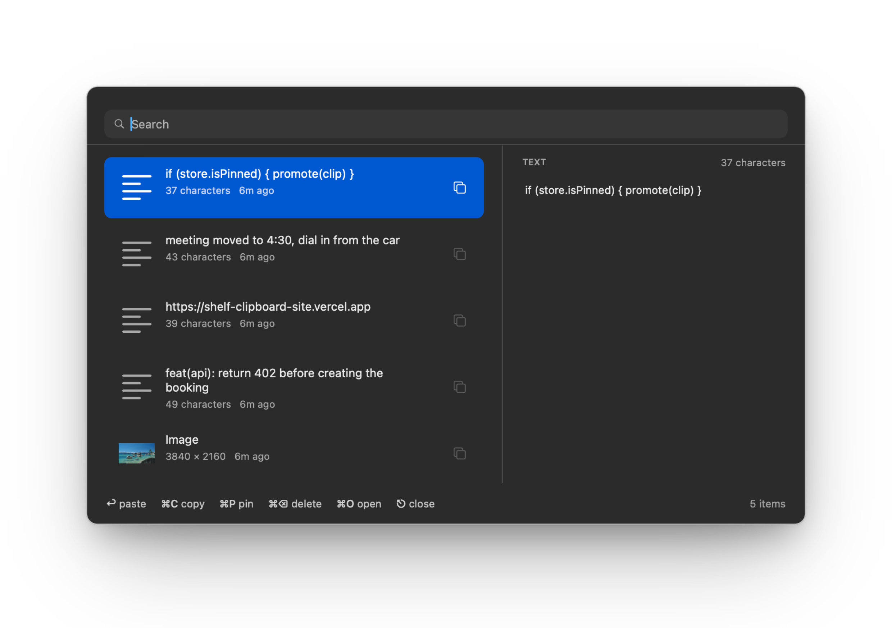

# Shelf

A clipboard shelf for macOS. Press `⌥V`, search what you copied, paste it back into whatever app you
were in. Free, MIT licensed, and local: history lives in `~/Library/Application Support/Shelf`, there
is no account and no network code.



One Swift file, no dependencies. Live at [shelf-clipboard-site.vercel.app](https://shelf-clipboard-site.vercel.app).

## Install

One command:

```sh
curl -fsSL https://raw.githubusercontent.com/sparshb4tra/shelf-clipboard/main/install.sh | bash
```

It downloads the latest release, installs to `/Applications` and clears the quarantine flag, so there
is no "damaged app" dialog. Prefer doing it by hand? Download the release, unzip, drag **Shelf.app** to
Applications, then right click → open once (the build is self-signed).

Or build it yourself:

```sh
git clone https://github.com/sparshb4tra/shelf-clipboard
cd shelf-clipboard
./build.sh
```

`build.sh` compiles with `swiftc`, signs, installs to `/Applications` and launches. Needs the Xcode
command line tools and macOS 14+.

On first paste macOS asks for Accessibility. That permission is what lets Shelf send the `⌘V` to the
app you came from. Without it, paste copies the clip and shows a hint instead.

Build flags: `SHELF_SKIP_INSTALL=1 ./build.sh` builds without installing (what CI runs),
`SHELF_SIGN_IDENTITY=...` picks a signing identity.

## Use

- `⌥V` opens the shelf over whatever you're doing, `esc` closes it
- type to search, `↑`/`↓` to move, `↩` pastes into the previous app
- right pane previews the selected clip: full image, full text, file icon or colour
- click the preview to open an image at full size, drag it to drop the image somewhere else
- `⌘C` copies, `⌘O` opens, `⌘P` pins, `⌘⌫` deletes, `⌘↩` pastes every selected clip
- the menu bar icon docks the shelf to the bottom, left or right edge, or leaves it as a floating
  window you can drag anywhere

History holds 300 clips. Pinned clips float to the top and are never trimmed. The menu bar item has
clear history, launch at login and about.

## Data

- `~/Library/Application Support/Shelf/history.json` — the index
- `~/Library/Application Support/Shelf/Blobs/` — images
- `~/Library/Application Support/Shelf/shelf.log` — event log, handy for debugging

Delete `history.json` or use Clear History in the menu bar to reset.

## How it works

- `Watcher` polls `NSPasteboard.changeCount` every 0.4s and captures text, images, file URLs, colours
- history is `history.json` plus a blob folder in Application Support, no database
- the panel is a borderless `NSPanel` with a view-based table and a search field
- the hotkey is Carbon `RegisterEventHotKey` on `kVK_ANSI_V` with `optionKey`
- paste: write the clip, hide, reactivate the previous app, post a synthetic `⌘V` with `CGEvent`
- drag: `NSDraggingSession` with PNG data, TIFF data and a temp file URL on the pasteboard

## Signing and the accessibility grant

macOS keys the Accessibility grant to the app's code identity. Ad-hoc signing (`codesign -s -`)
creates a new identity on every build, so macOS silently drops the grant and asks again each launch.
`build.sh` prefers a Developer ID, then any self-signed certificate named `Local Self-Signed`, and
falls back to ad-hoc with a warning.

To get a stable identity without a paid account, create a self-signed code signing certificate in
Keychain Access (Certificate Assistant → Create a Certificate → Code Signing) and name it
`Local Self-Signed`, or pass its name with `SHELF_SIGN_IDENTITY`.

## Roadmap

- [ ] drag clips straight out of the list, not just the preview
- [ ] per-app ignore list
- [ ] Homebrew cask + notarized release
- [ ] retention rules by age / type

## License

MIT © Sparsh Batra